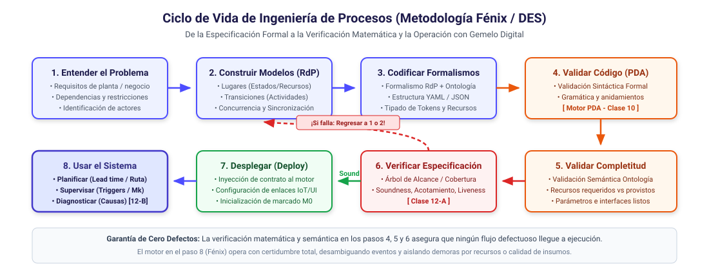

# Plataforma Educativa de Teoría de la Computación, Autómatas y Sistemas de Eventos Discretos (DES)

Esta plataforma interactiva y compendio didáctico están diseñados para el curso universitario de **Teoría de la Computación, Autómatas y Lenguajes Formales**. Permite a los estudiantes explorar de forma visual e intuitiva la transición desde la computación combinatoria hasta la concurrencia, el paso de mensajes y el **Control Supervisor de Workflows de Negocio y Producción**.

---

## 🌟 Características de la Plataforma Interactiva

El simulador web (SPA) está estructurado en 4 módulos progresivos:

1. **01. Combinatorio & Decisiones:** Simulación de funciones estáticas sin estado (\(y = x \cdot b\)) y lógica condicional si-entonces.
2. **02. Autómatas Finitos (DFA):** Procesamiento de cadenas binarias paso a paso sobre un grafo de estados interactivo.
3. **03. Autómatas de Pila (PDA):** Representación del reconocimiento de lenguajes libres de contexto con visualización animada de una **Pila física (LIFO)**.
4. **04. Procesos Cooperantes (Concurrencia & Workflows):** Simulación de paso de mensajes síncronos entre procesos.
5. **Lab. Recurso Único (DFA):** Simulador interactivo del ciclo operacional de una Estación de Pintura, que lanza errores de transiciones y permite descargar la especificación YAML.

---

## 🔄 Metodología de Ingeniería en 8 Pasos (Ciclo de Vida Fénix / DES)

Toda la asignatura converge en una metodología rigurosa para modelar, validar y ejecutar flujos de trabajo concurrentes en manufactura y negocios antes de pasar a producción:

1. **Entender el Problema:** Requisitos del dominio, dependencias, recursos y restricciones.
2. **Construir los Modelos (RdP):** Grafo bipartito de Redes de Petri (Lugares, Transiciones, Arcos).
3. **Codificar Basado en Formalismos:** Especificación estructurada (YAML/JSON) + Ontología de clases y recursos.
4. **Validar la Codificación (Motor PDA - *Clase 10*):** Verificación sintáctica formal de la gramática libre de contexto y balance de sub-procesos.
5. **Validar la Completitud de la Especificación (Ontología):** Verificación semántica estática (recursos requeridos vs. provistos, atributos obligatorios).
6. **Verificar la Especificación Dinámica (*Clase 12-A*):** Espacio de estados, Árbol de Cobertura, Invariantes y Teorema del Cierre de *Soundness* (van der Aalst). **¡Si falla la verificación, se regresa a los pasos 1 o 2!**
7. **Desplegar (*Deploy*):** Inyección del contrato formal verificado en el motor de ejecución.
8. **Usar el Sistema (*Run-Time* - *Clase 12-B*):** Operación en el motor (Fénix) como Gemelo Digital:
   * **Planificar:** Simulación de tiempos de ciclo (*lead time*) y ruta crítica.
   * **Supervisar:** Seguimiento en vivo por triggers de sensores con determinismo condicionado al marcado ($M_k$).
   * **Diagnosticar:** Descomposición causal de demoras (*¿Fricción por recursos, Calidad de insumos o Variabilidad?*).

---

## 🛠️ Motores y Simuladores de Consola (Python)

El repositorio incluye motores ejecutables correspondientes a cada bloque formal del curso:

* 🟢 **Motor DFA (Semanas 4-6):**
  * `recurso.py` y `recurso.yaml`: Autómata finito para ciclo de vida de recurso individual (Estación de Pintura).
  * Ejecución: `python recurso.py`
* 🟠 **Motor PDA (Semanas 7-9 - *Clase 10*):**
  * `recurso_pda.py` y `recurso_pda.yaml`: Autómata de pila (LIFO) para validación de jerarquías y sub-holones recursivos.
  * Ejecución: `python recurso_pda.py`
* 🔵 **Simulador y Diagnóstico de Redes de Petri (Semanas 11-12 - *Clases 11 y 12*):**
  * `recurso_petri.py` y `recurso_petri.yaml`: Motor formal algebraico ($C = I^+ - I^-$, $M_{k+1} = M_k + C \cdot u$).
  * Despacho de triggers con determinismo por marcado.
  * Simula 3 escenarios: caso nominal, demora por falta de recursos (cola), y demora por calidad de insumos defectuosa (lazo de retrabajo).
  * Ejecución: `python recurso_petri.py`

---

## 📑 Diapositivas de Clase (Beamer PDF)

En la carpeta [`slides/`](./slides/) se encuentran las presentaciones oficiales del curso en PDF (16:9):

* [Clase 10: El Motor PDA y Validación de Especificaciones](./slides/clase_10_motor_pda.pdf)
* [Clase 11-A: Redes de Petri y Lenguajes Concurrentes](./slides/clase_11A_petri.pdf)
* [Clase 11-B: Subclases, Fuentes, Temporización y Triggers en Fénix](./slides/clase_11B_petri.pdf)
* [Clase 12-A: Verificación Formal de Workflows: El Análisis Previo (Soundness)](./slides/clase_12A_petri.pdf)
* [Clase 12-B: El Motor en Acción: Planificación, Supervisión y Diagnóstico de Demoras](./slides/clase_12B_petri.pdf)

---

## 📚 Documentación del Curso

El repositorio incluye el material teórico y curricular desarrollado para el semestre de 14 semanas:

* 📄 **[SYLLABUS_14_WEEKS.md](./SYLLABUS_14_WEEKS.md):** Plan semestral semana a semana, detallando las clases teóricas y los hitos prácticos del proyecto integrador.
* 📖 **[THEORY_GUIDE.md](./THEORY_GUIDE.md):** Compendio de teoría del curso, desde gramáticas formales y BNF hasta Redes de Petri, Soundness, Sistemas de Eventos Discretos (DES) y Control Supervisor.
* 📋 **[YAML_SPECIFICATION.md](./YAML_SPECIFICATION.md):** Guía de sintaxis y ontología estructurada en YAML para modelar Procesos, Recursos y Productos de forma jerárquica.

---

*Desarrollado con pasión para brindar educación universitaria abierta de alta calidad.*
